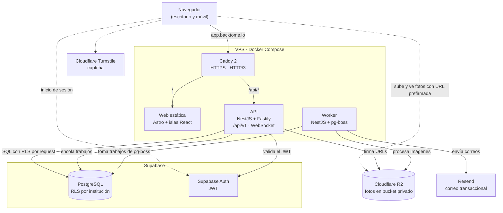

# BackToMe

> _"Lo que se pierde en tu organización, encuentra el camino de vuelta."_

Plataforma SaaS de objetos perdidos para instituciones educativas y empresas.

## Índice

1. [Descripción](#descripción)
2. [Tecnologías utilizadas](#tecnologías-utilizadas)
3. [Ejecutar el proyecto localmente](#ejecutar-el-proyecto-localmente)
4. [Integrantes del equipo](#integrantes-del-equipo)
5. [Metodología de trabajo](#metodología-de-trabajo)
6. [Arquitectura de la solución](#arquitectura-de-la-solución)
7. [Estado del proyecto](#estado-del-proyecto)
8. [Pruebas y calidad](#pruebas-y-calidad)
9. [Seguridad](#seguridad)
10. [Documentación de referencia](#documentación-de-referencia)

---

## Descripción

### Qué hace

BackToMe le da a cada institución un espacio propio y cerrado donde su comunidad **reporta, ubica y recupera objetos perdidos**, con trazabilidad completa de cada objeto:

- **Denuncias:** quien pierde algo lo publica con lugar, fecha y hora.
- **Encontrados:** el custodio (seguridad, portería, pañol) registra cada hallazgo, que queda _en custodia_ hasta su entrega.
- **Mis pertenencias con QR:** cada usuario registra sus objetos antes de perderlos e imprime stickers con un código QR. Quien encuentra el objeto escanea el código y el dueño recibe el aviso, sin que se expongan sus datos.
- **Catálogo ciego y reclamos:** la comunidad ve los hallazgos sin los rasgos que permiten reclamarlos. Para reclamar un objeto hay que demostrar que es propio.
- **Devolución con PIN:** retiro con PIN de un solo uso y registro de quién entregó, a quién y cuándo.
- **Administración:** el staff de BackToMe da de alta clientes, y el admin de cada institución gestiona los dominios de correo y las cuentas de su comunidad.

### A quién va dirigido

| Usuario                                   | Qué hace en la plataforma                                                          |
| ----------------------------------------- | ---------------------------------------------------------------------------------- |
| **Comunidad** (alumnos, colaboradores)    | Registra sus pertenencias, denuncia pérdidas, revisa hallazgos y reclama objetos   |
| **Custodio** (seguridad, portería, pañol) | Recibe hallazgos, escanea códigos QR, administra la custodia y entrega los objetos |
| **Admin de la institución**               | Configura los dominios de correo, los roles y las cuentas de su organización       |
| **Staff de BackToMe** (super admin)       | Da de alta, activa y desactiva clientes, y revisa el historial de la plataforma    |

Los clientes son **instituciones educativas** (universidades, institutos, colegios) y **empresas** (oficinas, sucursales).

### Qué problema resuelve

En la mayoría de las instituciones, los objetos perdidos se manejan con cuadernos, planillas o grupos de mensajería. Las consecuencias son:

- La mayoría de los objetos nunca vuelve a su dueño, porque quien pierde algo no sabe dónde preguntar y quien lo encuentra no sabe a quién avisar.
- Cualquiera puede reclamar un objeto ajeno describiéndolo después de verlo en una foto.
- No queda registro de quién recibió el objeto, quién lo tuvo en custodia ni a quién se le entregó.
- Se publican datos personales (nombres, teléfonos, documentos) en canales abiertos.

BackToMe centraliza el proceso en un solo lugar por institución. Exige verificar la propiedad antes de entregar un objeto, registra la custodia de punta a punta y aísla los datos de cada organización.

---

## Tecnologías utilizadas

| Capa                        | Tecnología                                                                                                    |
| --------------------------- | ------------------------------------------------------------------------------------------------------------- |
| **Lenguaje**                | TypeScript (estricto) sobre Node.js **24.21.0**, SQL (PostgreSQL)                                             |
| **Frontend**                | Astro (sitio estático) con islas React 19, Tailwind CSS v4, TanStack Query, React Hook Form, Radix UI, Lucide |
| **Backend (API)**           | NestJS con adaptador Fastify, WebSockets para notificaciones en tiempo real, Pino para logs                   |
| **Tareas en segundo plano** | NestJS (worker) con pg-boss (colas sobre Postgres), sharp para procesar imágenes                              |
| **Base de datos**           | PostgreSQL en **Supabase**, con Row Level Security (RLS) por institución y Drizzle ORM                        |
| **Autenticación**           | Supabase Auth (JWT), Cloudflare Turnstile como captcha                                                        |
| **Validación**              | Zod, con esquemas compartidos entre frontend y API (`@backtome/contracts`)                                    |
| **Correo**                  | React Email con Resend                                                                                        |
| **Almacenamiento**          | Cloudflare R2 (compatible con S3), bucket privado y URLs prefirmadas                                          |
| **Códigos QR**              | `qrcode` (generación), `jsQR` (escaneo con la cámara), `pdf-lib` (hoja de stickers en PDF)                    |
| **Cloud e infraestructura** | Supabase (base, Auth y colas), Cloudflare (R2 y Turnstile), VPS con Docker Compose y Caddy 2 (HTTPS y HTTP/3) |
| **Monorepo**                | pnpm 12.6.0 workspaces y Turborepo                                                                            |
| **Pruebas**                 | Vitest, pgTAP, Playwright con axe-core (accesibilidad), Lighthouse CI                                         |
| **CI/CD**                   | GitHub Actions                                                                                                |
| **Calidad de código**       | ESLint, Stylelint, Prettier                                                                                   |

---

## Ejecutar el proyecto localmente

La guía completa y actualizada está en **[quickstart.md](quickstart.md)**. Este es el resumen.

El aplicativo (web, API y worker) corre en tu equipo. La base de datos, Auth y las colas son las de **Supabase staging**, compartidas por todo el equipo.

### Requisitos

| Herramienta    | Versión                                                                          |
| -------------- | -------------------------------------------------------------------------------- |
| Git            | reciente                                                                         |
| Node.js        | **24.21.0** (fijado en `.nvmrc`; se instala con nvm)                             |
| pnpm           | **12.6.0** (se activa con `corepack enable`)                                     |
| `.env.staging` | Archivo de configuración que se comparte por el gestor de contraseñas del equipo |
| Docker Desktop | Solo para correr las pruebas automáticas                                         |

### Pasos

```bash
# 1. Clonar el repositorio
git clone https://github.com/BackToMeSaaS/BackToMe_SaaS.git
cd BackToMe_SaaS

# 2. Node y pnpm
nvm install 24.21.0
nvm use 24.21.0
corepack enable

# 3. Dependencias
pnpm install --frozen-lockfile

# 4. Configuración: copiar .env.staging en la raíz del proyecto
#    (desde el gestor de contraseñas; nunca se sube al repositorio)

# 5. Revisar la conexión con staging (solo lectura; todo debe salir en ✓)
pnpm db:staging:verificar
pnpm db:staging:migrar      # solo si el paso anterior marca migraciones pendientes

# 6. Levantar web, API y worker
pnpm dev
```

| Servicio | URL                                                   |
| -------- | ----------------------------------------------------- |
| Web      | http://localhost:4321                                 |
| API      | http://localhost:3000/api/v1 (salud en `/api/health`) |
| Worker   | Sin puerto: procesa correos y tareas programadas      |

Las cuentas demo para ingresar están en la [sección 6 de quickstart.md](quickstart.md#6-instituciones-y-cuentas-demo). Problemas frecuentes: [sección 5](quickstart.md#5-problemas-frecuentes).

### Base local (solo para pruebas automáticas)

Las pruebas de base de datos, API y e2e crean y borran cuentas, así que corren sobre una base local desechable en Docker y nunca contra staging:

```bash
pnpm preparar:local   # levanta Supabase local, aplica migraciones y genera .env.local
pnpm test:db
pnpm test:api
pnpm test:e2e
```

### Entornos

| Entorno        | Dónde corre                                                             | Para qué                                                 |
| -------------- | ----------------------------------------------------------------------- | -------------------------------------------------------- |
| **Local**      | Supabase CLI en Docker, desechable                                      | Solo pruebas automáticas                                 |
| **CI**         | GitHub Actions con Supabase local temporal                              | Validar cada push y pull request                         |
| **Staging**    | Proyecto Supabase en la nube                                            | Desarrollo diario (`pnpm dev`) y pruebas con correo real |
| **Producción** | Supabase (São Paulo) + VPS con Caddy, API y worker en Docker (`infra/`) | Usuarios reales; se despliega en cada push a `main`      |

---

## Integrantes del equipo

| Integrante           | Rol            | Responsabilidades                                                                                      |
| -------------------- | -------------- | ------------------------------------------------------------------------------------------------------ |
| **Mauricio Urrutia** | Product Owner  | Diseño de productos SaaS B2B y su equilibrio entre valor de negocio, privacidad y factibilidad técnica |
| **Lucero Leyva**     | Scrum Master   | Gestión ágil del proyecto y aseguramiento de calidad mediante pruebas automatizadas                    |
| **Renato Caro**      | Lead Developer | Desarrollo backend, modelamiento de datos y seguridad en bases de datos e infraestructura              |

---

## Metodología de trabajo

El equipo combina **Scrum**, **desarrollo guiado por especificaciones (SDD)** y prácticas **DevOps**.

### Scrum

- **Product Backlog** con historias de usuario (HU-01 en adelante) agrupadas por épica: administración global, autenticación, inventario personal y QR, catálogo ciego, custodia y devolución. Está en la [especificación técnica, §1.3](Docs/BackToMe_Especificacion_Tecnica.md).
- **Sprints** que toman historias del backlog priorizadas por el Product Owner.
- Roles de Product Owner, Scrum Master y equipo de desarrollo (ver [Integrantes](#integrantes-del-equipo)).
- Cada historia tiene una **Definición de Hecho** técnica: pruebas, accesibilidad, seguridad y documentación al día.

### Desarrollo guiado por especificaciones (SDD)

Cada funcionalidad se construye con [Spec Kit](https://github.com/github/spec-kit) en una carpeta `specs/NNN-nombre/`. Pasa por estas etapas:

```text
Historia de usuario → spec.md (qué y por qué) → plan.md (cómo) → tasks.md (tareas) → implementación → quickstart.md (validación)
```

Todas las specs respetan las reglas de la [constitución del proyecto](.specify/memory/constitution.md), que manda sobre specs, código, base de datos y diseño.

### DevOps

- **Integración continua** ([`ci.yml`](.github/workflows/ci.yml)): en cada push a `main` y en cada pull request corre lint, typecheck, pruebas unitarias, de base de datos y de API, build y Lighthouse.
- **Pruebas e2e** ([`e2e.yml`](.github/workflows/e2e.yml)): Playwright en escritorio y móvil, con verificación de accesibilidad.
- **Despliegue continuo** ([`deploy.yml`](.github/workflows/deploy.yml)): cada push a `main` se despliega a producción en la VPS por SSH, con Docker Compose.
- **Infraestructura como código**: Dockerfiles, `docker-compose.yml` y `Caddyfile` versionados en [`infra/`](infra/).
- **Migraciones versionadas**: los cambios de esquema son archivos SQL en `packages/db`, y se aplican con un comando (`pnpm db:staging:migrar`).

---

## Arquitectura de la solución

BackToMe es un **monorepo** con tres aplicaciones (web, API y worker) y paquetes compartidos. Usa una base de datos **multi-tenant**: todas las instituciones comparten la base, y cada una ve solo sus datos gracias a Row Level Security (RLS).



### Componentes

| Componente     | Responsabilidad                                                                                                                                              |
| -------------- | ------------------------------------------------------------------------------------------------------------------------------------------------------------ |
| **Caddy**      | Punto de entrada único. Sirve la web estática, hace de proxy inverso hacia la API y gestiona los certificados HTTPS                                          |
| **Web**        | Sitio Astro pre-generado. Las partes interactivas son islas React que consumen la API con TanStack Query                                                     |
| **API**        | Toda la lógica de negocio. Valida el JWT de Supabase y ejecuta cada consulta en una transacción con los datos del usuario, de modo que RLS se aplica siempre |
| **Worker**     | Tareas asíncronas y programadas: correos de activación y recuperación, procesamiento de fotos, vencimiento de denuncias, purga de datos                      |
| **PostgreSQL** | Datos de negocio, políticas RLS por institución, auditoría y colas de pg-boss                                                                                |
| **R2**         | Fotos de pertenencias y hallazgos. Los archivos no pasan por la API: el navegador sube directo con una URL prefirmada                                        |

### Principios de diseño

- **Una sola fuente de autorización.** RLS en la base aplica aunque falle una validación de la API (defensa en profundidad).
- **El frontend no escribe en la base.** Usa Supabase solo para iniciar sesión; todo lo demás pasa por `/api/v1`.
- **Mismo origen.** Web y API comparten dominio, así que no hace falta CORS y las cookies son seguras.
- **Sin Redis.** Las colas viven en Postgres con pg-boss, lo que reduce la infraestructura.

### Estructura del repositorio

```text
apps/web            Astro estático + islas React (landing, acceso y app)
apps/api            NestJS + Fastify (/api/v1), RLS por request, auditoría
apps/worker         NestJS + pg-boss (correos, imágenes, tareas programadas)
packages/contracts  Esquemas Zod compartidos entre frontend y API
packages/db         Migraciones SQL (Drizzle), esquema, datos de prueba, pgTAP y scripts de staging
packages/emails     Plantillas React Email y envío (Resend / Mailpit)
packages/config     Configuración compartida de ESLint, Stylelint, Prettier y tsconfig
infra/              Caddyfile, Dockerfiles y docker-compose de producción
e2e/                Playwright, axe y Lighthouse
supabase/           Configuración de la Supabase CLI (base local de pruebas)
scripts/            Preparación de la base local y carga de variables de entorno
specs/              Spec, plan, tareas y validación de cada funcionalidad (Spec Kit)
Docs/               Especificación técnica, paleta de colores, diccionario y textos legales
quickstart.md       Guía para instalar, levantar y probar
AGENTS.md           Instrucciones para asistentes de IA
```

---

## Estado del proyecto

| Spec                                                                                    | Qué entrega                                                                                   | Estado                    |
| --------------------------------------------------------------------------------------- | --------------------------------------------------------------------------------------------- | ------------------------- |
| [001 — Login e inicio de la app](specs/001-login-inicio-app/)                           | Landing, inicio de sesión, activación de cuentas, recuperación de contraseña e inicio por rol | Implementada (2026-10-06) |
| [002 — Gestión de dominios](specs/002-admin-dominios/)                                  | El admin gestiona los dominios de correo de su institución y el rol de cada uno               | Implementada (2026-10-07) |
| [003 — Gestión de clientes](specs/003-gestion-clientes/)                                | El staff crea, activa, desactiva y restaura clientes; historial de la plataforma              | Implementada (2026-10-12) |
| [004 — Registro e ingreso de la comunidad](specs/004-registro-ingreso-comunidad/)       | Detección de la institución por el correo al activar la cuenta                                | Implementada (2026-10-14) |
| [005 — Inventario "Mis bienes"](specs/005-inventario-mis-bienes/)                       | Registro de pertenencias con fotos en R2, edición y baja                                      | Implementada (2026-10-28) |
| [006 — Navegación superior y pertenencias](specs/006-navegacion-superior-pertenencias/) | Barra de navegación, menú de cuenta, resumen, varios colores y fotos por pertenencia          | Implementada (2026-11-02) |
| [007 — Código QR y stickers](specs/007-qr-stickers-pertenencias/)                       | Código QR firmado por pertenencia y hoja A4 de 12 stickers en PDF                             | Implementada (2026-11-02) |
| [008 — Denuncias de objetos perdidos](specs/008-denuncias-objetos-perdidos/)            | Publicar y gestionar denuncias, con vencimiento y purga automáticos                           | Implementada (2026-11-09) |
| [009 — Vista del custodio y hallazgos](specs/009-vista-custodio-hallazgos/)             | Registro de hallazgos, escáner QR, notificaciones en tiempo real                              | Implementada (2026-11-11) |
| [010 — Proceso de devolución](specs/010-proceso-devolucion/)                            | Reclamos, verificación de propiedad, retiro con PIN y configuración de cuenta                 | Implementada (2026-11-13) |

---

## Pruebas y calidad

| Comando                | Qué valida                                                                              |
| ---------------------- | --------------------------------------------------------------------------------------- |
| `pnpm lint`            | ESLint (accesibilidad, sin textos literales en la UI) y Stylelint (solo alias de color) |
| `pnpm typecheck`       | TypeScript estricto en todo el monorepo                                                 |
| `pnpm test`            | Pruebas unitarias con Vitest                                                            |
| `pnpm test:db`         | pgTAP: RLS, fugas de datos entre instituciones, inmutabilidad de la auditoría           |
| `pnpm test:api`        | Integración de la API contra Supabase local                                             |
| `pnpm test:e2e`        | Playwright en escritorio y móvil (390×844), con axe (WCAG 2.2 AA)                       |
| `pnpm test:lighthouse` | Landing: LCP menor a 2 s en 4G y menos de 60 KB de JavaScript                           |

`lint`, `typecheck` y `test` corren sin preparar nada. `test:db`, `test:api` y `test:e2e` necesitan la base local (`pnpm preparar:local`, con Docker).

---

## Seguridad

- **Aislamiento por institución:** cada request de la API corre con RLS, y las pruebas pgTAP verifican que no haya fugas de datos entre instituciones.
- **Secretos fuera del repositorio:** `.env.staging` y `.env.production` se comparten por el gestor de contraseñas; `.env.local` lo genera `pnpm preparar:local`. La plantilla sin valores es `.env.example`. La CI genera valores de prueba en cada ejecución.
- **Clave secreta acotada:** la clave secreta de Supabase solo existe en el worker y en los scripts de datos de prueba.
- **Conexiones cifradas:** TLS verificando la CA raíz de Supabase (`packages/db/certs/supabase-ca-2021.crt`).
- **Privacidad:** las fotos se guardan sin metadatos EXIF, los QR no se pueden adivinar y los PIN de retiro se guardan cifrados.
- **Protección de scripts:** la carga de datos de prueba y `pnpm preparar:local` se niegan a correr contra producción.

---

## Documentación de referencia

- [quickstart.md](quickstart.md): instalación, uso diario, datos demo y problemas frecuentes.
- [Constitución del proyecto](.specify/memory/constitution.md): reglas que mandan sobre specs, código, base de datos y diseño.
- [Especificación técnica](Docs/BackToMe_Especificacion_Tecnica.md): visión, backlog, arquitectura y modelo de datos.
- [Paleta de colores](Docs/BackToMe_Paleta_de_Colores.md) y [diccionario de términos](Docs/BackToMe_Diccionario.md).
- [Política de privacidad](Docs/legal/Politica_de_Privacidad_v0.md) y [términos de uso](Docs/legal/Terminos_de_Uso_v0.md).
- [specs/](specs/): spec, plan, tareas y validación de cada funcionalidad.
- [AGENTS.md](AGENTS.md): instrucciones para asistentes de IA.
